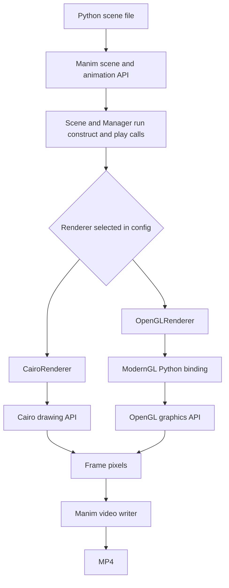

# Manim Code Study

First pass: 2026-11-17. This guide records a study of a small text-and-vector scene using Manim Community v0.22.1. The companion scene source is not included in this public repository; the class and output names below refer to that example. Manim internals and CLI behavior can change, so check the documentation for the version you use.

## The basic model



Python describes the objects and their timing. Manim routes the scene through one renderer, which draws frames; Manim then writes the frames to a video. Cairo and OpenGL are two rendering paths in the same Manim Community Python package.

## Concepts from smallest to largest

| Layer | What it means | In the example |
| --- | --- | --- |
| Values | Coordinates, colors, sizes, durations, and other settings. | `WHITE`, `BLACK`, positions, and `run_time`. |
| Mobject | An object with visual state and geometry. Mobjects can contain other mobjects. | `Text` and `Line`; `VGroup` is a group. A vector mobject stores path points. |
| Animation | A timed instruction for changing a mobject's state. It has a duration and a rate function. | `Create(underline)` or `line.animate.set_opacity(1)`. |
| Scene instance | The current canvas: its mobjects, renderer/camera, and scene settings. `add`, `play`, and `wait` describe the content and its sequence. | One `TextVectorStudy` instance with its own `mobjects` list. |
| Manager | The run coordinator attached to one scene. It owns execution state and a clock, handles play/wait calls, and runs setup, construction, teardown, and output finalization. | Created by `Scene.render()`; user scene code usually does not create it directly. |
| Renderer | Converts the current scene state into frame pixels using the selected drawing backend. | `CairoRenderer` or `OpenGLRenderer`. |
| Writer and video | Receives frames and assembles the requested output. | `SceneFileWriter` coordinates image/video output such as MP4. |

### Scene versus Manager

`Scene` is both the base class we subclass and, at render time, the live container for one animation. In a subclass, `construct()` is the recipe: create or add objects, then call `play()` and `wait()` in order. The scene keeps the on-screen mobjects in `scene.mobjects` and exposes `scene.time` as the elapsed animation time.

`Manager` is the runtime coordinator for that scene. When it attaches, it claims the renderer's execution state; its clock advances as plays and waits run. The scene's `time` property reads that same execution time through the renderer, so we can inspect time from the scene but do not normally update a clock ourselves. In the studied version, the render lifecycle is `setup()` -> `construct()` -> `tear_down()` -> output finalization (`post_construct()`).

The short mental model is: **mobjects are what exists; animations describe changes; the scene arranges them; the manager runs the timeline; the renderer draws frames; the writer makes the video.**

## Reading the example scene

- `from manim import *` imports Manim's public names so the file can use `Scene`, `Text`, `Line`, `VGroup`, colors, and animation helpers.
- `class TextVectorStudy(Scene)` defines a scene by inheriting Manim's `Scene` class.
- `construct()` is where the scene creates its objects and schedules what happens. The Manim CLI creates the scene and runs this method during rendering.
- `Text(...)` creates a text object. `Line(...)` creates a vector line. These are Manim objects, often called mobjects.
- `VGroup(...)` groups the text objects. `arrange`, `scale_to_fit_width`, and `move_to` set their layout before animation.
- `line.set_opacity(0)` makes every line start hidden. `self.add(text_lines)` puts the group in the scene; it stays hidden until an animation changes its opacity.
- `line.animate.set_opacity(1).set_color(BLACK)` describes a change over time. `self.play(...)` runs that change. Several animations passed to one `play` call happen together; `run_time` sets the duration in seconds.
- `Create(underline)` draws the vector line over time. `self.wait(0.35)` holds the current picture for 0.35 seconds.

The code builds editable objects and describes changes to them. It does not calculate each frame by hand.

## Python and OpenGL are different layers

The scene is Python. OpenGL is an optional renderer that draws what the Python scene describes; it is not a second language we need to write the scene in. Manim Community's other renderer is Cairo, selected by the default configuration in the studied setup. The CLI can override that setting with `--renderer=opengl`.

OpenGL is part of Manim Community. **ManimGL** is a separate project, distributed as the `manimgl` package. The import `from manim import *` uses Manim Community.

Manim has a renderer interface, so `Scene` and `Manager` can work with either renderer. This does not promise that every object behaves identically in both: parts of the code select Cairo- or OpenGL-specific object classes based on the renderer setting. The simple text-and-line scene used for this study worked with both after the background adjustment described below.

The two renderers do not implement every internal detail in the same way. In Manim Community v0.22.1, setting `self.camera.background_color` produced white in Cairo, but the first OpenGL render stayed black. The OpenGL renderer took its clear color from Manim's global `config.background_color`. Setting `config.background_color = WHITE` when the scene file loads, before Manim creates the renderer, made both paths use the intended white background. Verify this behavior against the version you use.

## Render either path

Run these from the project folder containing `main.py`, with that project's Python environment active:

```powershell
# Cairo is the default renderer.
python -m manim -ql -o TextVectorStudy-Cairo main.py TextVectorStudy

# Use the OpenGL renderer and a separate output name.
python -m manim --renderer=opengl -ql -o TextVectorStudy-OpenGL main.py TextVectorStudy
```

In the studied configuration, both commands rendered at 854×480 and 15 fps. Output went under `media/videos/main/480p15/`. `-ql` means low quality; it is separate from the `-l` live-preview option. OpenGL supports live preview with `--renderer=opengl -l`. Add `--format=mp4` if the live-preview run should also save a video. Quality presets and output paths depend on the Manim version and configuration.

## Typography render methods (2026-11-18)

### Fast preview

Use Manim's 720p30 preset to check wording, layout, and pacing quickly. Treat it as a draft preview, not the final sharpness check.

### High-resolution downsampling

For the higher-quality export in this test, render through Cairo at 7680×4320 and 60 fps in lossless RGB, then downsample once to 3840×2160 with FFmpeg's Lanczos scaler. Keep the 8K file as a temporary intermediate and use a compact 4K encode as the deliverable.

The plain-text variant, `TextVectorStudyNormal`, used Arial regular, the same wording and paced line reveal, a white background, gray inactive lines, and a black active line, without the cyan echo or retro decorations. The tested H.264 copy was 600,360 bytes (about 0.6 MB), 4.13 seconds, 4K60, and 248 frames.

H.265 was smaller in this test. Measurements on a text crop against the downsampled lossless reference:

| Encode | File size | Text crop PSNR | Text crop SSIM |
| --- | ---: | ---: | ---: |
| H.264 CRF 10 | 600,360 bytes | 61.05 dB | 0.999866 |
| H.265 CRF 18 | 451,253 bytes | 59.07 dB | 0.999738 |
| H.265 CRF 22 | 342,459 bytes | 55.91 dB | 0.999505 |

These are measurements from one short animation and one crop, not universal codec rankings. Check current delivery-platform requirements and compare the quality and compatibility of the actual content. Keep rendered outputs outside source control unless they are explicit project deliverables.

## A video project folder layout

One practical option is to keep each video in a dedicated project root, put Manim source at the root, and keep renders in separate `HIGH/` and `LOW/` folders:

```text
<video-project>/
├── main.py
└── render/
    ├── HIGH/
    │   └── scene_short-description_high.mp4
    └── LOW/
        └── scene_short-description_low.mp4
```

In this example, `HIGH` holds the 4K downsampled export and `LOW` holds a 720p30 preview. Name files by scene and a short description, then add `_high` or `_low` before the extension. Keeping the quality suffix aligned with its folder makes the resolution clear when a file is copied elsewhere.

## Where SDL and raylib fit

These names describe different kinds of tools, not different programming languages:

- **OpenGL** is a graphics API: programs send drawing commands and data through it. Its shaders use GLSL. In Manim, Python code reaches OpenGL through the ModernGL binding; we do not write OpenGL commands for this scene.
- **SDL** is a cross-platform C library for windows, input, audio, and other platform services. It can create an OpenGL window/context, or an app can use SDL's separate 2D renderer API. SDL is not a required layer in the Manim renderer path described here.
- **raylib** is a C game-programming library with higher-level drawing, input, and audio functions. Its `rlgl` layer abstracts supported OpenGL versions. It is a different application framework, not a renderer plug-in for Manim.

So “lower level” describes how much drawing and platform detail a tool exposes; it does not mean C, SDL, raylib, and OpenGL are all competing languages. Manim gives us a Python animation and video workflow. SDL and raylib are more suited to building interactive applications; OpenGL is one API they or other frameworks can use to draw.

## Where to read next in the source

These paths are relative to a Manim Community source checkout and are useful entry points:

- `manim/scene/scene.py` — `Scene` chooses the Cairo or OpenGL renderer and defines `play` and `wait`.
- `manim/manager.py` — coordinates the scene render lifecycle and passes play calls to the renderer.
- `manim/renderer/cairo/renderer.py` — Cairo frame drawing and animation playback.
- `manim/renderer/opengl/renderer.py` — OpenGL context, frame buffer, and animation playback; this module imports `moderngl`.
- `manim/mobject/text/text_mobject.py` — creates and arranges text objects.

Next, follow a call such as `self.play(line.animate...)` into Manim's animation builder and `Scene.play`, then into the selected renderer. Change one pause or line of text and compare the result.

## References

- [Manim examples](https://docs.manim.community/en/stable/examples.html) — official gallery of example scenes.
- [Manim configuration](https://docs.manim.community/en/stable/guides/configuration.html) — renderer selection, background color, and CLI options.
- [OpenGL rendering FAQ](https://docs.manim.community/en/stable/faq/opengl.html) — notes about the Community OpenGL implementation.
- [Manim version FAQ](https://docs.manim.community/en/stable/faq/installation.html) — Manim Community versus ManimGL.
- [ModernGL overview](https://moderngl.readthedocs.io/en/stable/the_guide/intro.html) — Python wrapper around the OpenGL pipeline.
- [Khronos OpenGL Registry](https://registry.khronos.org/OpenGL/index_gl.php) — OpenGL API and GLSL specifications.
- [SDL overview](https://wiki.libsdl.org/SDL3/FrontPage), [OpenGL context](https://wiki.libsdl.org/SDL3/SDL_GL_CreateContext), and [2D renderer](https://wiki.libsdl.org/SDL3/SDL_CreateRenderer) — SDL's platform and rendering interfaces.
- [raylib project](https://github.com/raysan5/raylib) and [FAQ](https://github.com/raysan5/raylib/blob/master/FAQ.md) — C game-programming library and its `rlgl` OpenGL abstraction.
- [Manim Community source](https://github.com/ManimCommunity/manim) — upstream repository.
